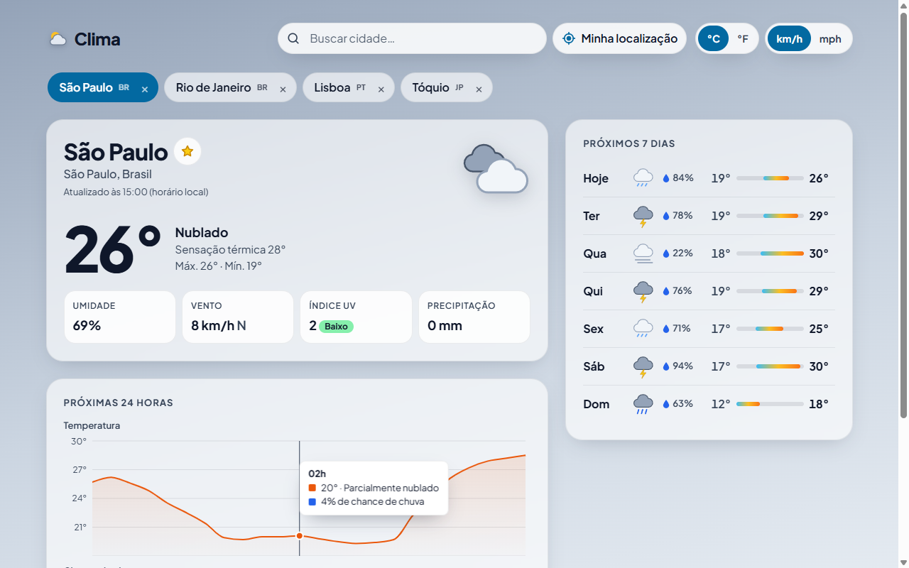

# Weather | React forecast dashboard

**Português:** [README.md](README.md)

A responsive weather dashboard built with React 19, TypeScript and TanStack Query on top of the
free, keyless [Open-Meteo](https://open-meteo.com/) API. Search any city with autocomplete or use
your location to see current conditions, a 24-hour chart and a 7-day forecast. Save favorite cities,
switch between °C/°F and km/h/mph, and watch the theme follow the weather and day/night at the
selected place. The UI is available in Brazilian Portuguese (default) and English.

**Demo:** https://portfolio.brunoisaac.dev/react-weather-dashboard/



## Highlights

- Debounced city search (accessible combobox) and browser geolocation with clear error messages.
- Current conditions, a 24-hour temperature / rain-chance chart (two synced charts instead of a
  dual-axis one, plus a data table) and a 7-day forecast with temperature range bars.
- Saved cities in `localStorage` with instant switching (the forecast is prefetched on hover).
- Units converted on the client: toggling them never refetches.
- Weather- and day/night-aware theme, skeletons, error states and an error boundary.
- i18n with i18next: pt-BR and en, typed resources, language switcher, locale-aware dates and
  numbers, weather codes in both languages and geocoding in the active language.

## Stack

React 19.2 · TypeScript 5.9 (strict) · Vite 7.3 · TanStack Query 5.90 · Recharts 3.7 ·
i18next 25.8 / react-i18next 16.5 · Vitest 4 + Testing Library + MSW 2 · ESLint 9 + Prettier 3.

## Internationalization

Initial language: saved choice (`localStorage` key `clima:language`) > browser language (`pt*` →
`pt-BR`, anything else → `en`) > `pt-BR`. Translations live in `src/i18n/locales/` (one TypeScript
file per language, split into feature namespaces); `pt-BR.ts` defines the keys and `en.ts` must
`satisfies LocaleResources`, so missing keys fail the type check. See the Portuguese README for how
to add a language.

## Running locally

```bash
npm install
npm run dev        # http://localhost:5173
npm test           # unit and component tests
npm run lint
npm run build
npm run build:cf   # production build served under /react-weather-dashboard/
```

No API key or environment variable is needed.

## Deploy

Published on Cloudflare (Workers static assets) at
https://portfolio.brunoisaac.dev/react-weather-dashboard/ by the pipeline of the
[portfolio](https://github.com/BrunoICosta/portfolio) repository, which runs `npm run build:cf` and
publishes `dist/`. This repository only runs CI (lint, formatting, tests and build).

## Author

Bruno Vinicius Isaac Costa · https://github.com/BrunoICosta · MIT License · Weather data by
Open-Meteo.com (CC BY 4.0)
