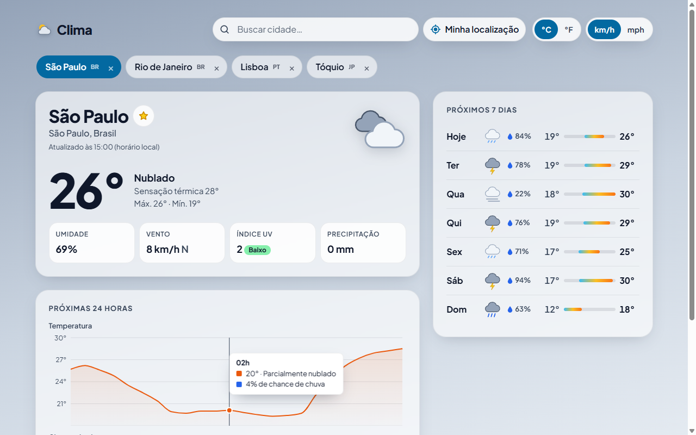

# Clima — React Weather Dashboard

Painel de clima responsivo feito com React 19, TypeScript e TanStack Query sobre a API pública
(e sem chave) do [Open-Meteo](https://open-meteo.com/). Busque qualquer cidade com autocomplete ou
use a sua localização para ver as condições atuais, um gráfico das próximas 24 horas e a previsão de
7 dias. Salve cidades favoritas para alternar entre elas rapidamente, troque entre °C/°F e km/h/mph,
e veja o visual se adaptar ao tempo e ao horário (dia/noite) do local consultado.

**Demo:** https://brunoicosta.github.io/react-weather-dashboard/



## Funcionalidades

- **Busca de cidades com autocomplete** — geocoding do Open-Meteo com debounce (350 ms), cache de
  um dia por termo e combobox acessível (setas, Enter, Esc, região `aria-live` com o total de
  resultados).
- **Usar minha localização** — Geolocation API com estados de carregamento, mensagens em pt-BR para
  permissão negada, posição indisponível e timeout, e acompanhamento da permissão via Permissions API.
- **Condições atuais** — temperatura, sensação térmica, máx./mín. do dia, umidade, vento com direção
  (N, NE, L…), índice UV com a categoria da OMS, precipitação, ícone SVG próprio e descrição em pt-BR
  para todos os códigos WMO.
- **Próximas 24 horas** — gráfico de temperatura (linha/área) e de chance de chuva (barras), com
  tooltips sincronizados e uma tabela com os mesmos dados para leitores de tela.
- **Previsão de 7 dias** — ícone, chance máxima de chuva e barras de amplitude térmica na mesma
  escala da semana.
- **Cidades salvas** — favoritos no `localStorage`, troca rápida por chips e _prefetch_ da previsão
  ao passar o mouse/focar, para a troca ser instantânea. A última cidade vista é restaurada.
- **Unidades** — °C/°F e km/h/mph, persistidas e convertidas no cliente (sem novas requisições).
- **Tema dinâmico** — fundo e tokens de cor mudam conforme o tempo (céu limpo, nublado, neblina,
  chuva, tempestade, neve) e dia/noite; à noite e em tempestades o tema fica escuro.
- **Estados de carregamento e erro** — skeletons que espelham o layout, estado de erro com
  "Tentar novamente" e _error boundary_ integrado ao `QueryErrorResetBoundary`.
- **Responsivo e acessível** — mobile first (testado a partir de 320 px), link "pular para o
  conteúdo", foco visível, rótulos e `aria-*` em todos os controles, respeito a
  `prefers-reduced-motion`.

## Stack

| Ferramenta                                        | Versão          |
| ------------------------------------------------- | --------------- |
| React / React DOM                                 | 19.2.4          |
| TypeScript (strict)                               | 5.9.3           |
| Vite + @vitejs/plugin-react                       | 7.3.1           |
| TanStack Query                                    | 5.90.21         |
| Recharts                                          | 3.7.0           |
| Vitest                                            | 4.0.18          |
| Testing Library (React 16.3.2, user-event 14.6.1) | —               |
| MSW (Mock Service Worker)                         | 2.12.10         |
| jsdom                                             | 28.1.0          |
| ESLint + typescript-eslint                        | 9.39.3 / 8.56.1 |
| Prettier                                          | 3.8.1           |

Estilos em CSS Modules + CSS moderno (custom properties, `color-mix`, `backdrop-filter`), sem
framework de UI.

## Arquitetura e decisões

- **Organização por feature** (`features/weather`, `search`, `location`, `cities`, `settings`,
  `theme`), com `core` para tipos e cliente HTTP e `shared` para componentes, hooks e utilitários
  genéricos. Cada feature expõe sua API, hooks e componentes; a composição acontece em `app/App.tsx`.
- **TanStack Query para o estado do servidor.** Uma única requisição traz condições atuais, horária
  e diária. As _query options_ ficam centralizadas (`forecastQueryOptions`) e são reaproveitadas
  pelo `useQuery` e pelo `prefetchQuery` dos favoritos. As coordenadas da chave são arredondadas
  (~1 km) para aumentar acertos de cache. `staleTime` de 10 min e `refetchInterval` de 15 min seguem
  a frequência de atualização do Open-Meteo; erros 4xx não são repetidos.
- **Unidades convertidas no cliente.** A API é sempre consultada em °C e km/h; a troca de unidade é
  só formatação, então não invalida o cache nem gera requisição.
- **Mapeamento para o domínio.** A resposta colunar do Open-Meteo é convertida em objetos
  (`mapForecast`) logo na camada de API. Horários usam o fuso do próprio local (`timezone=auto`) e
  são tratados como strings ISO locais — nada passa por `Date` com o fuso do navegador, evitando
  "dias trocados".
- **Dois gráficos em vez de eixo duplo.** Temperatura (°C) e probabilidade (%) têm escalas sem
  relação; empilhar dois gráficos com o mesmo eixo de tempo (`syncId`) é mais honesto do que um
  gráfico com dois eixos Y. As cores foram validadas para daltonismo e contraste nos temas claro e
  escuro.
- **Tema via atributos no `<html>`.** `getWeatherTheme` (função pura, testada) decide cena, período e
  tom; o CSS traduz isso em tokens. Componentes só usam variáveis, então o tema escuro não exige
  nenhum código condicional.
- **`localStorage` validado.** `useLocalStorage` valida o JSON lido com _type guards_; dados
  corrompidos ou de versões antigas caem no valor padrão em vez de quebrar a aplicação.
- **Testes com MSW.** Os testes de componente fazem requisições "reais" interceptadas pelo MSW
  (`onUnhandledRequest: 'error'`), cobrindo debounce, erros da API, retry e troca de unidades sem
  _refetch_.
- **Build.** Dependências separadas em _chunks_ (`react`, `query`, `charts`) para melhor cache; o
  `base` do Vite vem de `BASE_PATH` no deploy do GitHub Pages.

## Como rodar

Pré-requisitos: Node.js 22+ e npm 10+.

```bash
npm install
npm run dev          # ou npm start — http://localhost:5173
```

Outros scripts:

```bash
npm test             # testes (Vitest, uma execução)
npm run test:watch   # testes em modo watch
npm run lint         # ESLint
npm run typecheck    # checagem de tipos
npm run format       # Prettier
npm run build        # build de produção em dist/
npm run preview      # serve o build localmente
```

Nenhuma variável de ambiente ou chave de API é necessária.

## Estrutura de pastas

```
src/
├── app/                 # App, providers e configuração do QueryClient
├── core/                # cliente HTTP, tipos de domínio (Place) e constantes
├── features/
│   ├── cities/          # cidades salvas (hook + chips + botão de favoritar)
│   ├── location/        # geolocalização do navegador
│   ├── search/          # API de geocoding e combobox de busca
│   ├── settings/        # preferências de unidade (contexto + toggles)
│   ├── theme/           # tema por condição do tempo e dia/noite
│   └── weather/         # API de previsão, mapeamento, códigos WMO e componentes
├── shared/              # Card, Skeleton, ErrorBoundary, SegmentedControl, hooks e formatação
├── styles/              # estilos globais e temas
└── test/                # setup do Vitest, handlers do MSW, fixtures e helpers de render
```

## Próximos passos

- Nome real para "Minha localização" com um serviço de geocodificação reversa.
- Alertas meteorológicos e qualidade do ar (Air Quality API do Open-Meteo).
- PWA com cache offline da última previsão.
- Reordenar cidades salvas com arrastar e soltar.
- Testes end-to-end com Playwright.

## Licença e créditos

Código sob a licença [MIT](LICENSE). Dados meteorológicos por
[Open-Meteo.com](https://open-meteo.com/) (CC BY 4.0).

## Autor

Bruno Vinicius Isaac Costa — https://github.com/BrunoICosta
